# ecom-autopilot — an agentic Shopify theme-dev assistant built on Claude Code

> **Public showcase.** The production repo is private because it holds client stores, tickets and
> encrypted credentials. This repo contains the *mechanism* — orchestrator prompt, sub-agents, process
> gates (hooks), representative scripts — with every client name, store handle, ID and path scrubbed.
> The kit itself speaks Spanish (the operator's language); this README is in English.


## What it is

A freelance Shopify developer runs ~26 stores for clients and a drop-shipping team. Most of the work is
repetitive but unforgiving: clone a competitor's product page onto a client's theme, add a bundle offer,
remove a rival's branding, fix a cart drawer, keep the discount that is *displayed* equal to the one that
is *charged*. One wrong `theme push` overwrites what the merchant changed in the editor; one wrong store
handle ships a change to the wrong shop.

`ecom-autopilot` turns Claude Code into that developer's assistant. It is not a chatbot that explains
Liquid. It pulls the live theme, edits it, validates it, screenshots desktop and mobile, compares against
the reference pixel by pixel, pushes to an **unpublished** theme, and publishes only after the operator
says so in the chat. Everything it learns from a correction is written down and enforced the next time.

Numbers from the private repo as of 2026-10-17:

| Metric | Value |
| --- | --- |
| Commits since 2026-07-21 | ~1,800 (69 active days) |
| Stores managed (registry) | ~26 |
| Tickets (jobs) in memory | 147 |
| Error cards (one per correction or self-detected bug) | 228 |
| Lessons ("how it IS done") | 113 |
| Node scripts in `scripts/` | ~730 |
| Hook self-test | 43/43 green (runs in this repo too) |

## The problem it solves

LLM agents are good at *doing* and bad at *not doing*. In theme development the costly mistakes are
omissions: the backup you skipped, the mobile screenshot you did not take, the "publish" the client never
actually said, the add-on product you forgot to re-wire after migrating a bundle. Writing those rules in a
system prompt did not work (see **Key lesson** below). What worked was three layers:

1. **An orchestrator with a thin job**: read memory, identify the mode (fix / clone / from scratch) and the
   store, ask every question up front in one kickoff message, then dispatch sub-agents.
2. **Hooks that act as process gates**, each backed by evidence the model cannot fabricate.
3. **A memory that is written while working**, not at the end: tickets, store cards, error cards,
   lessons, client taste. Corrections become rules; rules that repeat get promoted into the hooks.

## Architecture

```
CLAUDE.md                     orchestrator prompt: identity, hard scope, modes, design decalogue, memory rules
.claude/agents/               6 sub-agents, each with its own tools and a written "what you must NOT do"
  tema.md                     edits Liquid / JSON on the live pull, pushes to an UNPUBLISHED theme
  clonador.md                 convergence loop: capture reference + clone, diff report, fix, repeat to 0 differences
  qa-visual.md                read-only QA: desktop + mobile captures by viewport segment, real clicks on every control
  catalogo.md                 Admin GraphQL (products, discounts, menus, pages) — only on explicit request
  imagenes.md                 Gemini / Nano Banana image generation with the real product attached as reference
  archivero.md                writes memory (tickets, error cards, lessons) and commits it immediately
.claude/hooks/                the gates (PreToolUse, PostToolUse, Stop, UserPromptSubmit, SessionStart)
  _gate-lib.mjs               evidence readers: transcript, per-session state, file mtimes, store registry
  _gate-checks.mjs            the publish / safe-push / admin-graphql checks
  pre_tool.mjs                BLOCKS unsafe Bash and image calls (exit 2)
  post_tool.mjs               records what was really edited / pushed / mutated in this session
  cierre.mjs                  BLOCKS ending the turn with memory uncommitted, ticket missing, correction unfiled…
  prompt_submit.mjs           detects "closing the shift" and corrections in the operator's own words
  session_start.mjs           git pull, warns if behind, injects the gate summary
.claude/commands/             slash commands (/visor, /publicar, /clonar-rival, /fix-ticket, /cierre, /curar…)
scripts/                      12 representative scripts out of ~730 (see below)
memoria/                      (private) tickets, stores, clients, errores/, aprendido/, referencias/, gustos.md
stores/registry.yml           index of stores (no tokens); per-store .env files travel encrypted
```

### Flow of one job

```mermaid
flowchart LR
    A[git pull + read memory<br/>INDEX, taste, error recall] --> B[Kickoff: all questions<br/>in ONE message]
    B --> C[theme pull --live<br/>source of truth = live theme]
    C --> D[backup-theme.mjs]
    D --> E[edit Liquid / JSON<br/>sub-agent: tema]
    E --> F[validate_theme<br/>Shopify Dev MCP]
    F --> G[captura.mjs<br/>desktop + mobile PNG, read by the model]
    G --> H{clone?}
    H -- yes --> I[convergencia.mjs<br/>ref vs clone, written diff report<br/>repeat until 0 differences]
    H -- no --> J
    I --> J[safe-push.mjs<br/>UNPUBLISHED theme, --nodelete]
    J --> K{Gate: pre_tool.mjs}
    K -- operator OK in transcript<br/>backup < 24h, validate, captures,<br/>0-diff report, live checks --> L[theme publish]
    K -- anything missing --> M[BLOCKED, exit 2<br/>model sees what is missing]
    L --> N[memory: ticket, store card,<br/>error cards, commit + push]
    N --> O{Gate: cierre.mjs}
    O -- memory pushed, ticket written,<br/>corrections filed, confirmation block --> P[turn ends]
    O -- missing --> M
```



### The gates, concretely

Every check reads something the model cannot write itself:

| Gate | Evidence it reads | What it blocks |
| --- | --- | --- |
| publish / push-live | last **human** prompt in the transcript (`origin.kind = human`) matched against an approval regex, later than the last push | publishing without the operator's real "OK" |
| publish / safe-push | mtime of `backups/<store>/`, timestamp of the last `validate_theme` tool use, mtimes of desktop **and** mobile captures | pushing untested or unvalidated code |
| clone lock | `capturas/.clonando-<store>` + diff report containing "0 diferencias" + a declared GO-LIVE section (currency, display = charge, rival branding, checkout logo) | reporting a clone as done while it still differs |
| live checks | storefront `.js` of the product: `available:true`, handle is initials-only, rival brand absent from HTML | "it's published" when the visitor sees sold-out or a competitor's name |
| admin-graphql | the mutation text | readable product handles, discount codes with `endsAt`, any `*Delete` without `--force` |
| image generation | transcript: did the operator ask for images or approve them? | spending money on images nobody asked for |
| close of turn (Stop) | git status of `memoria/`, mtimes of tickets/error cards vs. the time of the correction, first line of the final message, a 12-point confirmation block | ending with unsaved memory, an unfiled correction, or a "done" without evidence |

A dry run is one command away: `node scripts/gate.mjs estado <store>` tells the model what is missing
*before* it tries. `node scripts/gate-selftest.mjs` runs 43 fixture-based tests of the hooks (green in this repo).

### Memory that learns from corrections

- `memoria/tickets/<date>-<client>.md` — every job, created the moment it arrives, with the request verbatim and a
  `Etapa:` line (PENDING / IN PROGRESS / WAITING FOR OPERATOR / BLOCKED / DONE) appended on every stage change.
- `memoria/errores/<date>-<what-happened>.md` — one card per correction, with the operator's exact words, how it
  was detected and the rule "for always", written in its most general honest form.
- `memoria/aprendido/<topic>.md` — reusable technique (how the cart drawer of theme X really works, how Markets
  gate storefront availability, why a CSS token is not evidence of a rendered color).
- `memoria/gustos.md` — the operator's taste, distilled into a design decalogue that is re-read before every
  design task.
- `/curar` — periodic curation: dedupe, generalize, prune, and **promote anything repeated in 2+ cards to a rule
  in CLAUDE.md or a hook**, with the evidence in the commit.

## Key lesson: process rules only work when the harness enforces them

From the private lesson file `aprendido/normas-de-proceso-requieren-enforcement.md` (2026-08-11, updated 2026-09-10):

> The convergence-loop rule (capture reference and clone after every edit, compare, repeat) was violated 3 times
> in 2 days despite being written in CLAUDE.md, repeated by the operator and filed as an error card. In the same
> period, the one hook that *blocks* closing a session with uncommitted memory was obeyed 100% of the time.
> The difference is not how important the rule is. It is who executes it.

Why a model skips written rules: a line in the system prompt competes with the immediate task and skipping it
produces no visible error; context compaction and model switches dilute it; there is a post-edit bias ("I just
wrote it, it's fine"); and an expensive rule (two screenshots and a comparison) loses against the urge to finish.

An audit on 2026-09-10 made it measurable: 99 error cards in 5 weeks, 43 of them marked "hard rule", and the same
families repeating (`clon` 30, `proceso` 22, `qa` 16, `realidad` 11) despite 30 commits of prose in CLAUDE.md.
Only the two rules that were wired into hooks were being followed.

The general rule the project runs on since then:

> A process rule that must hold 100% of the time is not written in prose. It is implemented as a hook, backed by
> evidence the model cannot fabricate, with a script that makes compliance cheap (one command) and leaves a
> verifiable marker (a timestamp). The text in CLAUDE.md remains documentation, not the mechanism.

Honest limit: a hook guarantees the screenshots are *taken*; that they are *looked at* properly is still on the model.
What cannot be measured (the currency painted in a mock-up, the real charge of a discount, the checkout logo) is
required as a written declaration with evidence, which forces the model to look.

## Stack

- **Node 22**, ES modules, no framework. ~730 small scripts, each one does one thing and can be run by hand.
- **Shopify CLI 4** for pull / push / publish / dev server, always through a per-store wrapper that loads that
  store's credentials without printing them. Raw `theme push` is blocked by a hook.
- **Shopify Admin GraphQL** (pinned API version) for catalog, discounts, menus, pages, Files — only on explicit request.
- **Shopify Dev MCP** for live docs and `validate_theme` before anything is shown.
- **Playwright** for visual QA: full-page and viewport-segment captures, desktop + mobile, real clicks on every
  control, scroll curves measured every 100 px on both the reference and the clone.
- **Discord bot** (REST, no 24/7 process): reads tickets from the team's channels, keeps an orders board with a
  slash command, confirms payments by reaction.
- **Gemini / Nano Banana** for images, always with the real product attached as a reference image, and only after
  the operator approved the prompt (hook-enforced).
- **Secrets**: each store's `.env` travels in git as `.env.enc` (AES-256-GCM); the key lives outside the repo and is
  carried by hand to each device. A session-start hook decrypts what arrived and re-encrypts what changed. The
  close-of-turn gate blocks if a touched `.env` was not pushed encrypted.
- **Claude Code** as the runtime: sub-agents in `.claude/agents/`, hooks in `.claude/hooks/`, slash commands in
  `.claude/commands/`, skills for design taste and Liquid.

## What is in this repo

| Path | Notes |
| --- | --- |
| `CLAUDE.md` | the orchestrator prompt, sanitized (names, handles, org IDs and personal paths replaced) |
| `.claude/agents/*.md` | the 6 sub-agents, sanitized |
| `.claude/hooks/*.mjs` | all 9 hooks, runnable |
| `.claude/commands/*.md` | the slash commands |
| `.claude/settings.json` | how the hooks are wired |
| `scripts/safe-push.mjs` | the only way code reaches a store: unpublished theme, `--nodelete`, store identity check |
| `scripts/gate.mjs`, `scripts/gate-selftest.mjs` | gate dry-run CLI + 43 fixture tests |
| `scripts/demo-gates.mjs` | replays 5 unsafe actions against the hooks, no credentials needed |
| `scripts/convergencia.mjs` | captures reference + clone in one go, arms the clone lock |
| `scripts/captura.mjs` | Playwright desktop + mobile full-page capture of the dev server or a live URL |
| `scripts/secretos.mjs` | AES-256-GCM encrypt / decrypt / sync of per-store `.env` files |
| `scripts/admin-graphql.mjs` | Admin API runner with the `*Delete` guard |
| `scripts/shopify-tienda.mjs`, `scripts/backup-theme.mjs` | per-store CLI wrapper, theme backup |
| `scripts/discord-pull.mjs`, `scripts/discord-orders.mjs` | read-only ticket reader, orders board bot (IDs moved to env) |
| `docs/DEMO-SCRIPT.md`, `docs/demo.gif` | recording script and the terminal demo |
| `stores/registry.yml` | a two-store example of the index (the real one lists ~26 stores, no tokens) |

Not included: `memoria/` (clients, tickets, store cards), per-store `.env.enc`, theme pulls, captures, informes,
HANDOFF documents, and ~720 one-off scripts named after specific stores.

## Try the gates locally

```bash
git clone https://github.com/Morijuu/ecom-autopilot-showcase && cd ecom-autopilot-showcase
node scripts/gate-selftest.mjs      # 43/43 green
node scripts/demo-gates.mjs         # 5 unsafe actions, all blocked with the message the model would see
node scripts/gate.mjs estado demo-store
```

No Shopify credentials are needed for any of the above: the hooks only read local evidence.

---

Built and operated daily since July 2026 by Pablo Morell ([@Morijuu](https://github.com/Morijuu)).
Source shown for evaluation; contact the author for reuse.
